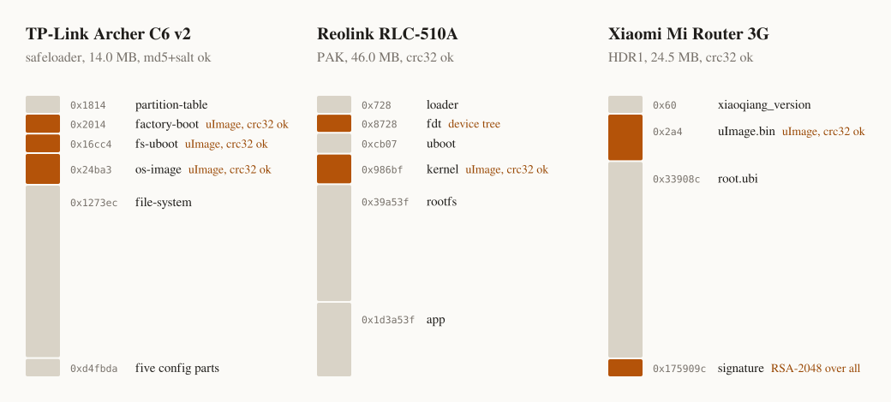

# firmhead

firmhead reads the headers wrapped around router and embedded firmware and tells you what is
inside: where each part starts and ends, what it is, how it is compressed, which checksums hold,
and which bytes a signature covers. It works on a buffer you already have, in C99, and never
decompresses or opens a file.

<p align="center">
  <picture>
    <source media="(prefers-color-scheme: dark)" srcset="docs/map-dark.svg">
    
  </picture>
</p>

Every offset it hands back lies inside the buffer it was given, whatever the size fields in the
image claim.

## Formats

| format | checked | signatures reported |
|---|---|---|
| uImage, legacy and multi-file | CRC-32 of the data | |
| TRX v1 and v2 | CRC-32 of the image | |
| OpenWrt fwtool trailer | | usign key id |
| TP-Link v1 | salted MD5 | |
| TP-Link safeloader | MD5, salted or not | RSA-1024 |
| Xiaomi HDR1 | CRC-32 of the image | RSA-2048 |
| MikroTik NPK | | vendor signature |
| Netgear CHK | Netgear sum of each part | |
| Reolink PAK | CRC-32 of the image | |
| D-Link SEAMA | MD5 of the data | |
| Ubiquiti | CRC-32 of header, parts and image | RSA-2048 |
| Android boot, header v0 to v4 | SHA-1 of the images | |
| U-Boot FIT | hash nodes of each image | each signature node |
| device tree | structure | |

A checksum is `ok`, `bad`, or `unverifiable` when the format gives no way to check it. For a
signature it gives the algorithm, where the signature bytes sit and, when the signed bytes form one
range, that range, so the caller verifies it with whatever crypto it already trusts.

## FIT audit

`fwh_audit`, or `FWH_OPEN_AUDIT` at open, looks for the FIT signing mistakes that let an unsigned
kernel boot: weak hashes or keys, images signed without a configuration, signed configurations that
load unsigned images, keys present but not required, and node names that can be read two ways.

## Example

[`examples/firmhead-info.c`](examples/firmhead-info.c) scans a file and prints every header it
finds, or one JSON object per file with `-j`:

```text
$ firmhead-info miwifi_r3g_firmware_dbc3c_2.28.46.bin
hdr1@0x0 size 24482204: HDR1, xiaoqiang_version, uImage.bin, root.ubi
  part  xiaoqiang_version    0x00000060        529 other
  part  uImage.bin           0x000002a4    3378613 other
  part  root.ubi             0x0033908c   21102592 other
  part  signature            0x0175909c        256 signature
  check crc32      whole image   ok             6792f20f
  sig   xiaomi/signature rsa2048 whole image covers whole image
        value 0x175909c+256, appended at 0x175908c
uimage@0x2a4 size 3378613: "MIPS OpenWrt Linux-3.10.14", linux, mips, kernel, lzma
  part  kernel               0x000002e4    3378549 kernel    lzma
  check crc32      data          ok             8d5a9b50
```

It exits with 3 when any checksum is `bad` and 1 on read errors, so a script can stop on a
damaged download. `include/firmhead/firmhead.h` is the API reference.

## Rules of the API

- a call that can fail returns `FWH_OK` or an error code, and `fwh_strerror` names it
- what `fwh_open` returns is freed by `fwh_image_destroy`, which accepts `NULL`
- the image borrows the buffer, which stays alive and unchanged until then
- nothing takes ownership of its arguments; returned pointers belong to the library
- `fwh_open` takes a `fwh_allocator_t`, or `NULL` for `malloc` and `free`
- `FWH_OPEN_STRICT` refuses an image with a `bad` checksum (`FWH_ERR_DAMAGED`, with `error_at`
  pointing at it)

## Install

```sh
cmake -S . -B build -DBUILD_SHARED_LIBS=ON
cmake --build build
cmake --install build --prefix /usr/local
```

Then `find_package(firmhead)` and `firmhead::firmhead` from CMake, or
`pkg-config --cflags --libs firmhead`. To vendor it instead, `scripts/amalgamate.sh` writes the
single header `dist/firmhead/firmhead.h`; one `.c` file defines `FWH_IMPLEMENTATION` before
including it, and `FWH_STATIC` keeps the functions private to that file.

## Versions

Semantic Versioning: an incompatible change bumps the major version and the soname.
`FWH_VERSION_STRING` is the version compiled against and `fwh_version()` the one loaded. The
[CHANGELOG](CHANGELOG.md) says what each release means for existing code, [SECURITY.md](SECURITY.md)
how to report a flaw. MIT licensed.
